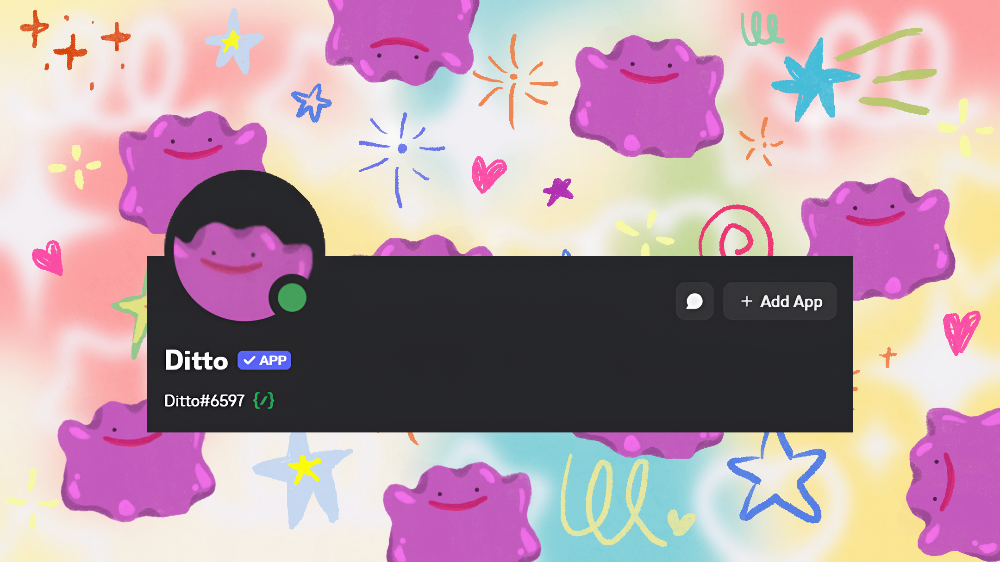

# Ditto Bot

[](https://www.python.org/)
[](https://discord.com/)
[](https://discordpy.readthedocs.io/)

A custom Discord bot built with Python using ```discord.py```. Features include automated moderation, user interaction commands, and integration with external APIs. Designed to be modular, scalable, and easy to extend for custom server needs.

Currently being used in a community of over **32,000 members** and actively maintained.

✨ [Invite Ditto to your server](https://discord.com/oauth2/authorize?client_id=1318567932661338183&permissions=2147502112&integration_type=0&scope=bot) ✨

## Usage

| News Updates | |
| --- | --- |
| **/setptcg <channel> <role>** | Set the channel and role for **PTCG** news updates |
| **/setpocket <channel> <role>** | Set the channel and role for **Pocket** news updates |

<br/>

| Regex | |
| --- | --- |
| **/setregex <pattern>** | Set a regex pattern for word checking |
| **/removeregex** | Remove the regex pattern |
| **/addignoredchannel <channel>** | Add a channel to be ignored by the regex check |
| **/removeignoredchannel <channel>** | Remove a channel to be ignored by the regex check |
| **/listignoredchannels** | Lists all channels ignored by the regex check |
| **/settrading <channel>** | Set the trading channel that users will be redirected to when the regex triggers |
| **/trading** | Manual command to tell users how to access the trading channels |

## Features

| Feature |  |
| --- | --- |
| **Automatic Updates** | Checks for updates every hour and automatically posts new articles to a discord channel |
| **Article Embedding** | Takes the article title, image, and first paragraph to create an embed link that is easy to read and understand |
| **Channel & Role Settings** | Set a posting channel & role for each news topic |
| **Regex Word Matching** | Set a regex pattern for automatic checks |
| **Auto Redirect to Trading Channels** | Uses the regex patterns to automatically find and redirect users to the appropriate trading channels |
| **SQLite Database** | Uses SQLite to manage posted articles, server channels, server roles, regex patterns, ignored channels, and trading channels |
| **Activity Logging** | Logs every interaction to a local text file |